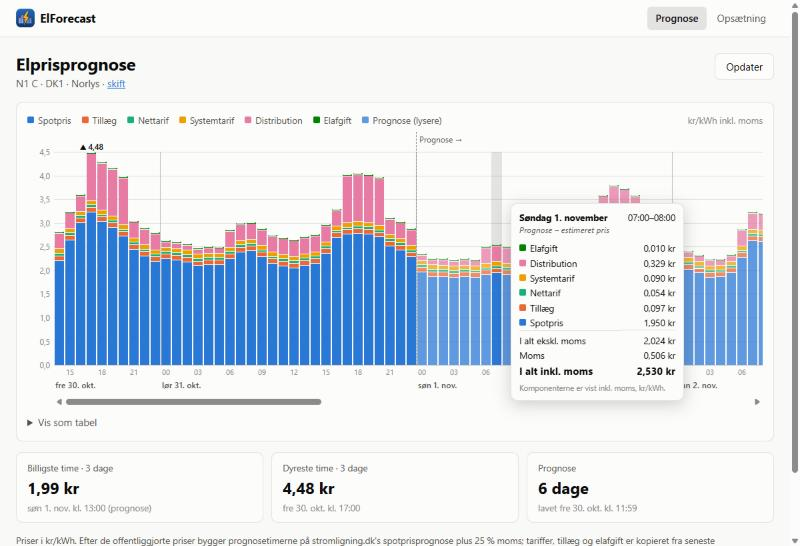

# StromPriser – know when electricity is cheap

See what electricity really costs your household, hour by hour, and plan the washing machine,
the dishwasher or the car charging for the cheap hours. Prices include everything on the bill,
not just the spot price, and they reach about a week ahead.



All prices come from the free public service at [stromligning.dk](https://stromligning.dk).
The apps themselves are in Danish.

## Two ways to use it

| | **ElForecast** – in the browser | **StromPriser** – on Windows |
|---|---|---|
| Best for | A quick look at the week ahead, on your phone or computer | Detailed numbers, and saving them to Excel |
| Shows | A bar chart of every hour for about 8 days | Tables of every period, with the cheapest one highlighted |
| Install | Nothing, just open the page. It can also be added to your home screen. | A small Windows program |

## ElForecast: the week ahead in the browser

**First time:** choose **Opsætning** and pick:

1. **Netselskab**: the company that owns the cables to your home. It is printed on your
   electricity bill.
2. **Kundegruppe**: normally the preselected private customer group.
3. **Elhandelsselskab** and **Produkt**: who you buy your electricity from. Pick *(intet)* to
   see the plain market price without any company's surcharge.
4. **Vis priser inkl. moms**: tick it to see what you actually pay, including VAT.

Press **Gem og vis prognose**. Your choices are remembered in this browser, so next time
the forecast opens straight away.

**Reading the chart**

- Each bar is one hour. The taller the bar, the more that hour costs.
- The colours show what the price is made of. Blue at the bottom is the market price, which
  changes from hour to hour. The layers on top are the fixed parts of the bill (see below).
- The lines across the chart are 0.50 kr apart. A vertical line marks each midnight, with the
  date below it.
- Bars to the right of the dashed **Prognose** line are forecasts and are drawn in lighter
  colours. Bars to the left are the official prices.
- ▼ marks the cheapest hour and ▲ the most expensive one, picked from today and the next two
  days. Further out the forecast is too uncertain to plan by.
- Hover over a bar, or tap it on a phone, to see the exact price and what it is made of.
- Scroll sideways to see more days. **Vis som tabel** shows the same numbers as a table.

The boxes below the chart show the cheapest and the most expensive hour in the same three days,
and how many days the forecast covers and when it was last updated. Press **Opdater** for
fresh numbers.

## StromPriser: the Windows app

Pick your companies in the four drop-downs, just like in ElForecast, and press
**Hent priser**. You get:

- a summary with the cheapest and the most expensive period and how much you save by moving
  your consumption,
- what the cheapest period's price is made of,
- a table of every period for the next 24 hours, with the cheapest row in green and the most
  expensive in red.

Tick **Medtag prognose** to see about a week ahead, and **Vis pr. time** for one row per hour
instead of every quarter of an hour. **Gem som fil...** saves what you see as a CSV file that
opens directly in a Danish Excel, or as JSON. Your choices are remembered between runs.

## What makes up the price?

| Part | What it is |
|---|---|
| **Spotpris** | The market price of the electricity itself. It changes every hour (every 15 minutes, in fact). |
| **Tillæg** | Your electricity company's surcharge on top of the market price. |
| **Nettarif** and **Systemtarif** | Energinet's charges for the national grid. |
| **Distribution** | Your local grid company's charge. It is usually highest in the late afternoon and early evening. |
| **Elafgift** | The state electricity tax. |
| **Moms** | 25 % VAT on all of the above. |

## How good is the forecast?

The official prices for tomorrow are published around 13:00 every day. Everything after that
is a forecast, and it is only an estimate:

- The **market price** comes from the forecast at stromligning.dk. It is often close, but
  wind, weather and demand can change it a lot from one day to the next.
- The **other parts** are copied from the most recent official price at the same time of day.
  Changes between weekdays and weekends, or seasonal tariff changes, are not taken into
  account.

Use the forecast to spot the cheap days and hours ahead. Check the official prices before
relying on a single hour.

## For developers

The repository holds three .NET 10 projects. Each has its own README with the technical details:

| Project | |
|---|---|
| [Stromligning](Stromligning/README.md) | Class library for the stromligning.dk API: prices with the full breakdown, the forecast, CSV/JSON export. Has no UI, so it can be reused anywhere. |
| [ElForecast](ElForecast/README.md) | The Blazor WebAssembly app. It is deployed by FTP from GitHub Actions on every push to `main`. |
| [StromPriser](StromPriser/README.md) | The Windows Forms app. |

```bash
dotnet run --project ElForecast     # http://localhost:5276
dotnet run --project StromPriser    # Windows only
```

## License

[MIT](LICENSE) © 2026 Per Hejndorf. Price data from [stromligning.dk](https://stromligning.dk).
