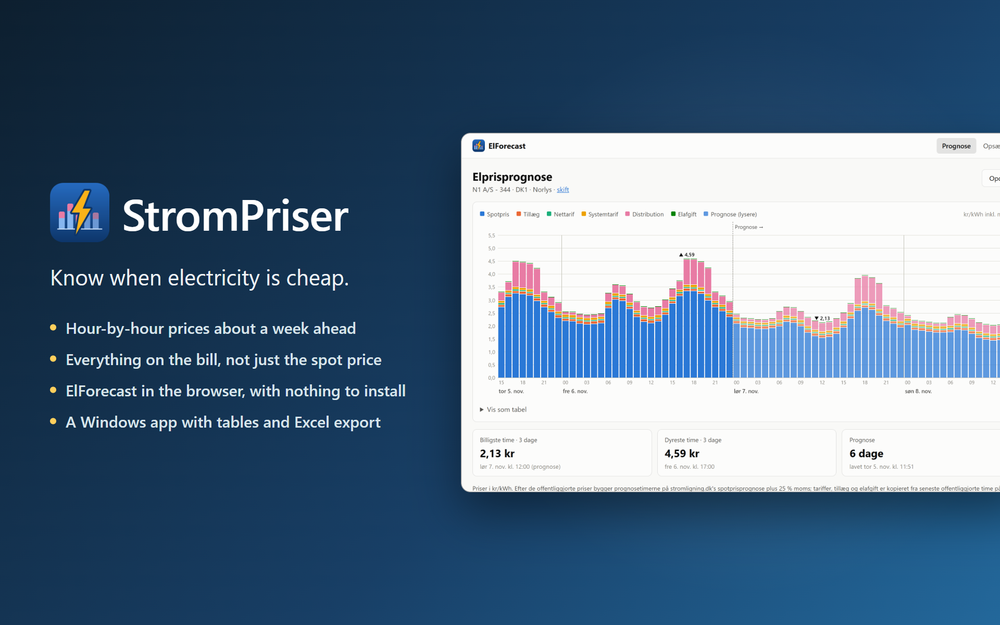
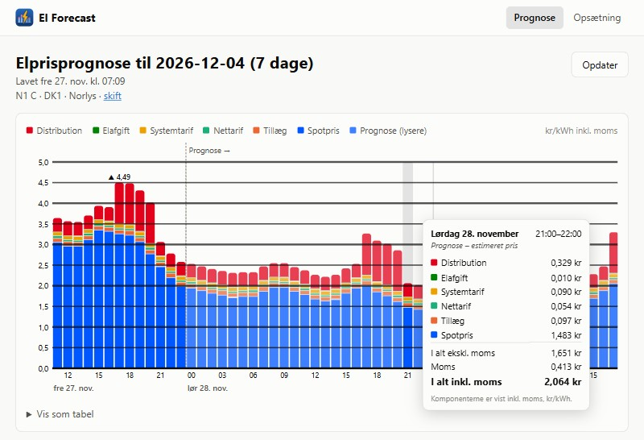

# El Forecast – know when electricity is cheap

[](https://kreaton.github.io/ElForecast/)
[](LICENSE)


[](https://github.com/kreaton/ElForecast/stargazers)

⭐ If El Forecast earns a place on your machine, [star it on GitHub](https://github.com/kreaton/ElForecast) — it's free, made by one developer, and stars are how other people find it.



See what electricity really costs your household, hour by hour, and plan the washing machine,
the dishwasher or the car charging for the cheap hours. Prices include everything on the bill,
not just the spot price, and they reach about a week ahead.

**Open El Forecast: <https://kreaton.github.io/ElForecast/>**

All prices come from the free public service at [stromligning.dk](https://stromligning.dk).
The app itself is in Danish. There is nothing to install: just open the page, on your phone
or computer. It can also be added to your home screen.

## El Forecast: the week ahead in the browser

**First time:** choose **Opsætning** and pick:

1. **Netselskab**: the company that owns the cables to your home. It is printed on your
   electricity bill.
2. **Kundegruppe**: normally the preselected private customer group.
3. **Elhandelsselskab** and **Produkt**: who you buy your electricity from. Pick *(intet)* to
   see the plain market price without any company's surcharge.
4. **Vis priser inkl. moms**: tick it to see what you actually pay, including VAT.

Press **Gem og vis prognose**. Your choices are remembered in this browser, so next time
the forecast opens straight away.

**Reading the chart**



- Each bar is one hour. The taller the bar, the more that hour costs.
- The colours show what the price is made of. Blue at the bottom is the market price, which
  changes from hour to hour. The layers on top are the fixed parts of the bill (see below).
- The lines across the chart are 0.50 kr apart. A vertical line marks each midnight, with the
  date below it.
- Bars to the right of the dashed **Prognose** line are forecasts and are drawn in lighter
  colours. Bars to the left are the official prices.
- ▼ marks the cheapest hour and ▲ the most expensive one, picked from today and the next two
  days. Further out the forecast is too uncertain to plan by.
- Hover over a bar, or tap it on a phone, to see the exact price and what it is made of.
- Scroll sideways to see more days. **Vis som tabel** shows the same numbers as a table.

The boxes below the chart show the cheapest and the most expensive hour in the same three days,
and how many days the forecast covers and when it was last updated. Press **Opdater** for
fresh numbers.

## What makes up the price?

| Part | What it is |
|---|---|
| **Spotpris** | The market price of the electricity itself. It changes every hour (every 15 minutes, in fact). |
| **Tillæg** | Your electricity company's surcharge on top of the market price. |
| **Nettarif** and **Systemtarif** | Energinet's charges for the national grid. |
| **Distribution** | Your local grid company's charge. It is usually highest in the late afternoon and early evening. |
| **Elafgift** | The state electricity tax. |
| **Moms** | 25 % VAT on all of the above. |

## How good is the forecast?

The official prices for tomorrow are published around 13:00 every day. Everything after that
is a forecast, and it is only an estimate:

- The **market price** comes from the forecast at stromligning.dk. It is often close, but
  wind, weather and demand can change it a lot from one day to the next.
- The **other parts** are copied from the most recent official price at the same time of day.
  Changes between weekdays and weekends, or seasonal tariff changes, are not taken into
  account.

Use the forecast to spot the cheap days and hours ahead. Check the official prices before
relying on a single hour.

## For developers

The repository holds two .NET 10 projects. Each has its own README with the technical details:

| Project | |
|---|---|
| [Stromligning](Stromligning/README.md) | Class library for the stromligning.dk API: prices with the full breakdown, the forecast, CSV/JSON export. Has no UI, so it can be reused anywhere. |
| [ElForecast](ElForecast/README.md) | The Blazor WebAssembly app. It is deployed to GitHub Pages from GitHub Actions on every push to `main`. |

```bash
dotnet run --project ElForecast     # http://localhost:5276
```

## License & Authorship

This project is distributed under the terms of the [MIT License](LICENSE).

Price data from [stromligning.dk](https://stromligning.dk).

**AI authorship note:** Most of the source code in this repository was generated with AI coding agents (Claude Code), under my direction and review. Purely AI-generated material may not be eligible for copyright protection in some jurisdictions. To the extent any part of this project is protected by copyright, it is licensed under the MIT License, and the license's warranty and liability disclaimers apply to the project as a whole.

<!-- notices:start -->
### Independent development

El Forecast is an independent, personal project developed by Per Hejndorf. It is not affiliated with, endorsed by or sponsored by Microsoft or any other rights holder (including Strømligning). Product names and logos are trademarks of their respective owners and are used only to identify the services and tools the project works with.

### Third-party notices and asset provenance

[THIRD-PARTY-NOTICES.md](THIRD-PARTY-NOTICES.md) lists every third-party library, font and online service the project uses, with version, licence, source and whether it was modified. It also records where the icons, images, audio and video came from and how they are licensed. A few assets are not covered by the MIT License; [THIRD-PARTY-NOTICES.md](THIRD-PARTY-NOTICES.md) marks them and states their terms.
<!-- notices:end -->
